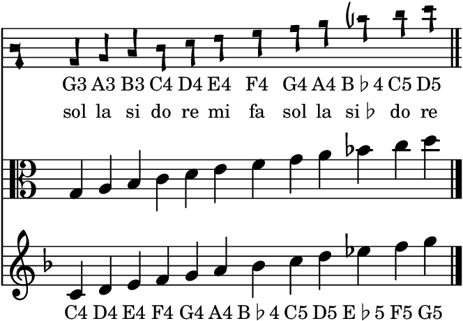
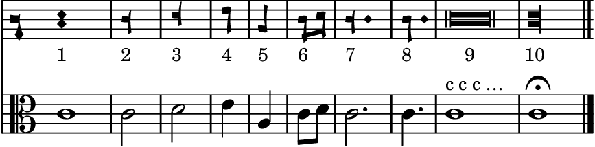
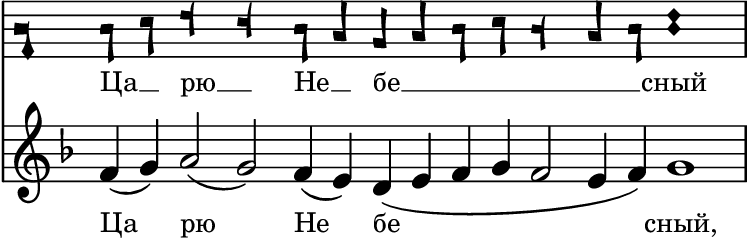

# Reading square notation

The old Synodal chant books in `references/` are printed in **square
notation**: the Obikhod (1909), the Pentecostarion (1899), *Праздники*
(1900). It is also called Kievan or Synodal notation, *квадратная нотация*,
*киевское знамя*, or *топорики* ("little axes"). This is a guide to
reading it, with the details checked against
«Царю Небесный» in the Pentecostarion, p. 311, whose melody is in
`znamenny/tsaryu_nebesnyj_znamennyj.mscz` (see "Worked example").

In short: **it is a C clef on the middle line, so the middle line is C
(*do*). The notes are the modern note values in other shapes, and some of
those shapes are two heads that stand for one note.**

The pictures were made with LilyPond, which has this notation built in
(the Synodal style, as printed in the 1910s). They are drawn from
`square_notation/square_notation.ly`, and the build command is in that
file.

Every Znamenny score in `znamenny/` also has a square-notation
counterpart in `znamenny/square/` (made with `tools/kievan-ly.py`), to
read next to its modern version.

## The staff and the clef

The staff has five lines, as in modern notation. There is only one clef,
the **C clef**, in Russian *цефаутный ключ* ("tsefaut", from the old
solmization name "C fa ut"). It looks like a small key, or a half note
with a stem down to a diamond. Its square head sits **on the middle line,
and that line is C**. In the Synodal books it is always there, so there
is no key signature (Simmons; Andreev, Shardt and Simmons).

So yes, it is a C clef, and the line it marks looks like the "B position"
only if you think in treble clef: in treble clef the middle line is B, in
a C clef on that line it is C. It is the same as the modern **alto clef**
(the viola clef), which also puts C4 on the middle line. Checked on p. 311:
the clef's head sits on the middle line, and with C there the first
notes read C D | E D | C B, the melody of `tsaryu_nebesnyj_znamennyj.mscz`
a fourth lower (see "Worked example").

## The scale

The chant uses twelve notes, the *обиходный звукоряд* (the "gamut"): G A
B C D E F G A B♭ C D, from the first space up to the second ledger line
above the staff. It is built from four groups of *do re mi fa*, each
starting on the *fa* of the one before: G A B C, C D E F, F G A B♭,
B♭ C D. So the lower B (the space below the middle line) is **B natural**,
and the high B (on the first ledger line above the staff) is **B♭**.
The books print a special flat sign only before that high B, as in the
picture. There are no sharps and no naturals (Simmons; Andreev, Shardt and
Simmons).

The pitch is relative: C on the middle line means *do*, which a choir
sings wherever it suits the voices. There are three ways to read it:

1. **As an alto clef**, as in the second staff above: middle line C4.
2. **As a treble clef in B♭ major** (two flats; Simmons' tip): every note
   stays where it is printed, and the high B♭ becomes an A♭. This is
   everything a semitone lower than (1), and is the quickest way for
   someone used to the treble clef.
3. **A fourth higher, in F major** (the third staff above). Then *do* is
   F, the low B natural becomes E, and the high B♭ becomes E♭. All the
   Znamenny scores in `znamenny/` are in F major, and this is why: in
   this scale a transposition by a fourth (*do* to *fa*) changes nothing
   (Andreev, Shardt and Simmons, footnote 1).

## The notes

In transcriptions the square notes keep their values. A half note stays
a half note, and so on: in «Царю Небесный» each square note has the value
it has in the modern edition (checked for the first phrase, see below).
Simmons advises feeling the half note as the beat ("cut time").

| | shape | value | where the pitch is |
|---|---|---|---|
| 1 | **two diamonds**, one above the other | whole note | **between** the two diamonds |
| 2 | square with a short stem up and a long stem down | half note, on a line | the square |
| 3 | square with a long stem up and a short stem down | half note, in a space | the square |
| 4, 5 | square with one stem, down or up | quarter note | the square |
| 6 | two diamonds with a stem; beamed in pairs | eighth notes | the **upper** diamond |
| 7, 8 | a dot after the note | dotted half, dotted quarter | |
| 9 | **two long rectangles** joined | recitative mark: several syllables sung on this one note | **between** the rectangles |
| 10 | **two short rectangles** joined, at the end | final note, may be held | **between** the rectangles |

The half and the quarter are easy to confuse. The quarter has one stem,
and the half has a stem on both sides. In the Synodal books the half note
has two forms, depending on whether it sits on a line or in a space (2
and 3; Andreev, Shardt and Simmons). A quarter's stem may go up or down
at the engraver's choice. Notes on one syllable often all have the same
direction, whatever their position, so the direction tells you nothing
(Andreev, Shardt and Simmons, fig. 8).

### The signs that look like Gregorian chant

These are the shapes with **two heads for one note**: the whole note
(1, two diamonds), the eighth (6), the recitative mark (9) and the final
note (10). They look like Gregorian neumes of two notes, such as a pes or
a clivis, or like two puncta inclinata. **They are single notes.** Their
pitch is the line or space between the two heads, or the upper diamond
for the eighth. Andreev, Shardt and Simmons note the likeness and stress
that these "are not ligatures but single characters". There are no
ligatures in square notation (Wikipedia, «Киевское знамя»).

### Other signs

- **No slurs.** The notes sung on one syllable are printed close
  together, and the groups are separated by space.
- **Bar lines** (a single vertical line) separate phrases. They are not
  measures.
- **The end of a piece** has its own sign after the final note, like a
  double bar line followed by a curve.
- There is no clef change and no time signature.

## Worked example: «Царю Небесный», p. 311

The Pentecostarion (1899), p. 311 (`references/triod_1899/`, PDF p. 108;
also `references/znamenny/triod_1899_tsaryu_nebesnyj_p311.pdf`): «По 50-м
псалме, стихира, глас 6». The first phrase, read with C on the middle line
(above), and as in `tsaryu_nebesnyj_znamennyj.mscz`, a fourth higher in F
major (below):

On the page:

- **«Ца»**: two quarters, stems down: C (on the middle line), D (the space
  above).
- **«рю»**: two half notes, with a stem on both sides: E (the second line
  from the top), D.
- **«не»**: two quarters: C, B (the space below the middle line).
- **«бе́с»**: seven notes on one syllable, printed as one close group.
- **«ный»**: a whole note, two diamonds.

The pitches were read by eye for «Ца-рю не» only. For «бе́с» and «ный»
only the shapes were checked (the group of seven, the whole note).

Moved up a fourth, C D | E D | C B becomes F G | A G | F E, and the values
of «Ца», «рю», «не» and «ный» (quarters, halves, quarters, a whole) are
those of the modern edition. The upper staff of the picture is
LilyPond's drawing, not a copy of the page: on the page the stems and the
spacing differ a little.

## Sources

- N. Simmons, *A Primer of Kievan Square-note (Quadratic or Synodal)
  Musical Notation*, May 2004. 10 pp.: the clef, the note shapes, the
  scale, Alleluia in all eight tones. Its old address
  (synaxis.info/psalom/research/simmons/Kievan_notation.pdf) is gone, but
  it survives in the
  [Wayback Machine](https://web.archive.org/web/2012id_/http://www.synaxis.info/psalom/research/simmons/Kievan_notation.pdf).
  `references/square_notation/simmons_kievan_notation.pdf`.
- A. Andreev, Yu. Shardt, N. Simmons, *Proposal to Encode Mediæval
  East-Slavic Musical Notation in Unicode*, L2/12-327, 4 October 2012
  ([PDF](https://www.unicode.org/L2/L2012/12327-kievan.pdf)). The
  characters, the two half-note forms, the flat sign only with the high
  B, the clef ("functionally similar to the alto clef"), and the shapes
  that look like Gregorian ligatures. Its examples come from the 2004
  reprints of the Obikhod and *Праздники*.
  `references/square_notation/unicode_L2-12-327_kievan.pdf`.
- [Wikipedia, «Киевское знамя»](https://ru.wikipedia.org/wiki/Киевское_знамя):
  the five-line staff, the single clef, the two diamonds as one pitch,
  the dot, no ligatures, groups of notes on one syllable.
- LilyPond manual,
  [Typesetting Kievan square notation](https://lilypond.org/doc/v2.26/Documentation/notation/typesetting-kievan-square-notation),
  used for the pictures.
- Not read: D. N. Solov'ev, «Краткое руководство к первоначальному
  изучению церковного пения по квадратной ноте» (St Petersburg, 1889),
  the handbook that the Unicode proposal's figures 1 and 2 come from.
